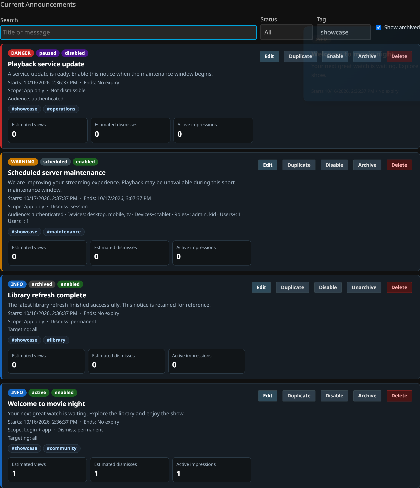
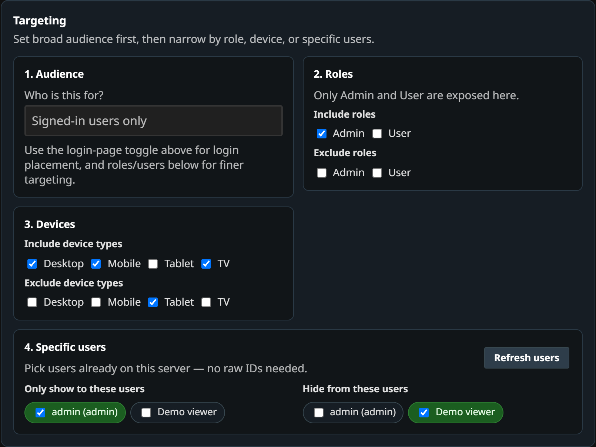
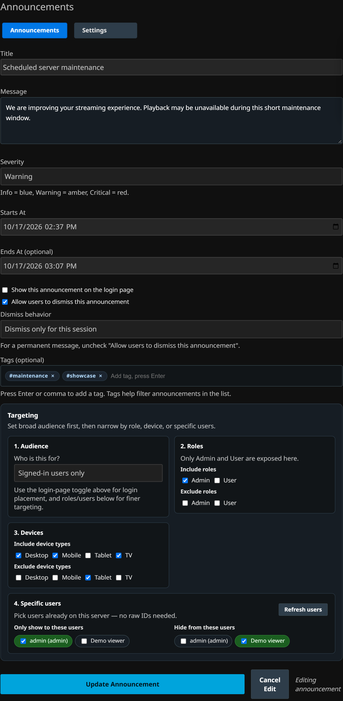
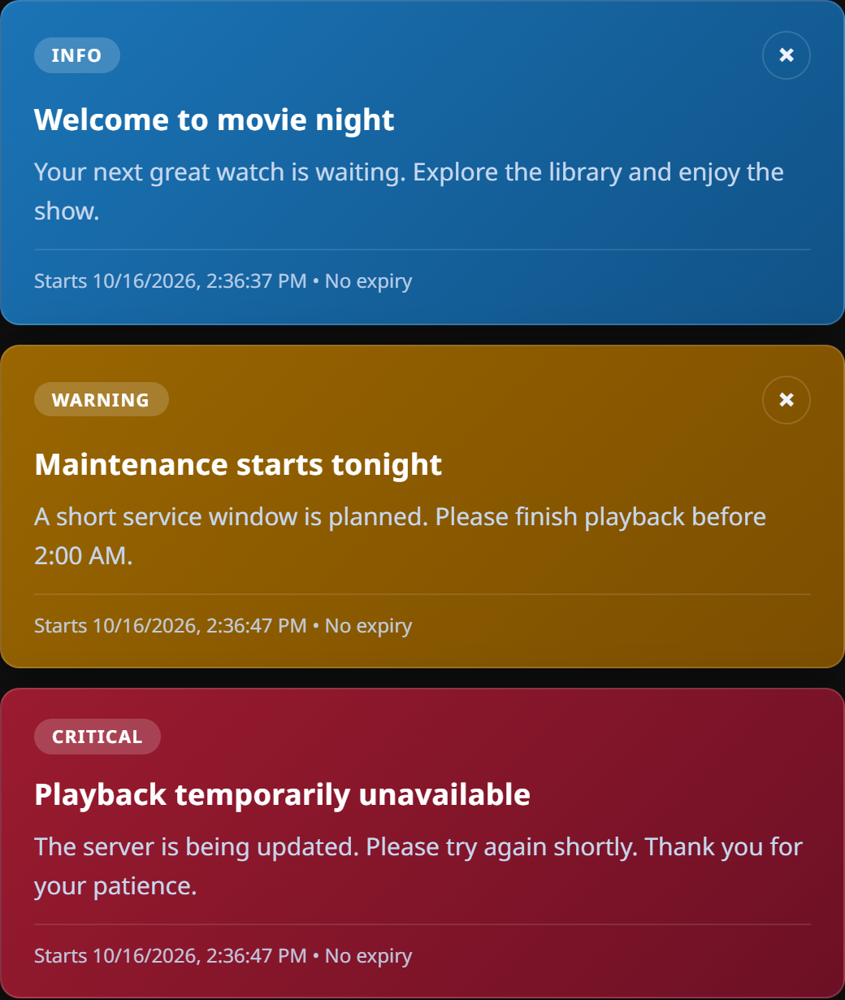
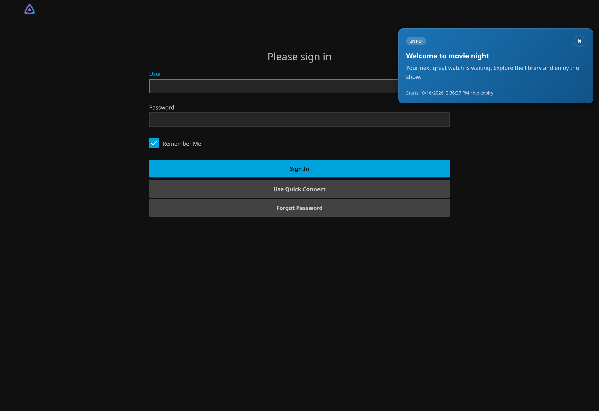
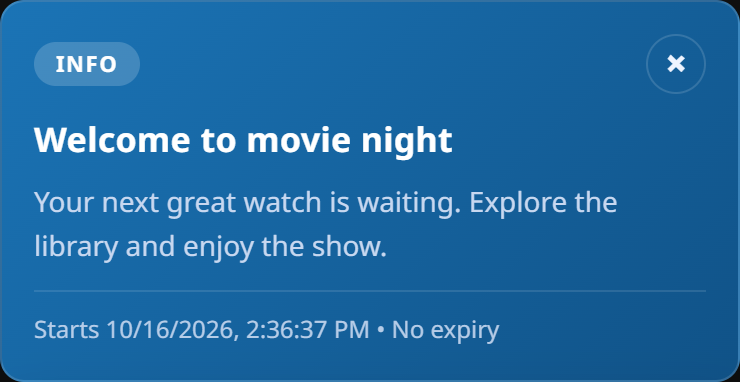
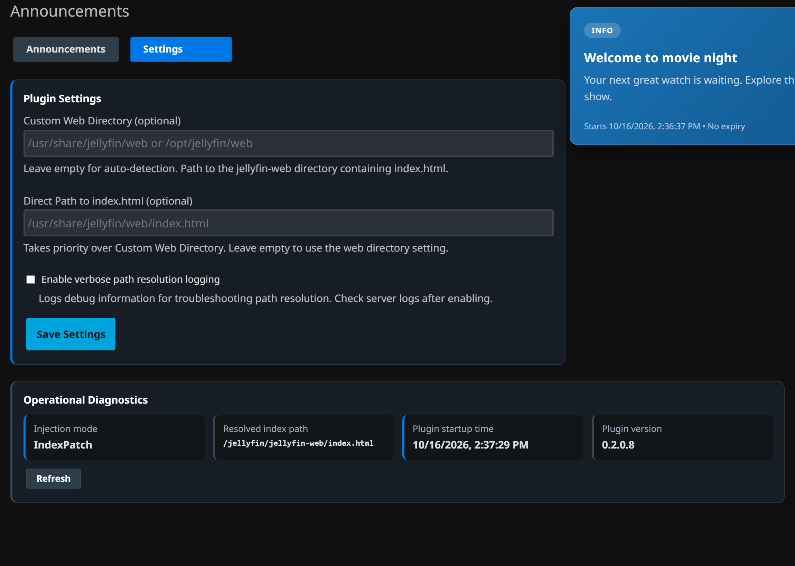

# Jellyfin Announcements Plugin


Server-wide announcements and maintenance banners for Jellyfin.

## Status

- Version: 0.2.0.8
- Target Jellyfin ABI: 12.0.0.0
- Framework: .NET 10

## Features

- Admin CRUD for announcements
- Basic announcement analytics: views, dismisses, active impressions
- Tag-based organization and filtering
- Duplicate, archive/unarchive, and enable/disable admin actions
- Operational diagnostics for injection mode and resolved path
- Severity-based messaging: Info, Warning, Critical
- Optional start/end scheduling
- Audience targeting for all users, signed-in users, admins, and related segments
- Device targeting with include/exclude rules for desktop, mobile, tablet, and TV
- Specific-user targeting with live Jellyfin user pickers in the admin editor
- Login-page visibility toggle per announcement
- Optional dismiss controls
- Dismiss behavior: session or permanent
- Auto-load banner script support through index patching
- Runtime banner refresh on login/logout and account switching without requiring a manual browser refresh

## Branding


The plugin catalog metadata now points at the hosted project logo so the Jellyfin manifest can display branded artwork after release.

## Screenshots

Screenshots show version 0.2.0.8 in Jellyfin 12.1 with sample announcements. Open an image to view it at full resolution.

**Manage announcements:** search, tags, schedule status, enable/disable, archive/unarchive, duplicate, delete, and estimated analytics.



**Choose who sees each announcement:** audiences, roles, devices, and specific-user inclusion/exclusion.



<details>
<summary>Full editor: message, severity, scheduling, login visibility, dismissal behavior, and tags</summary>



</details>

<details>
<summary>Live banners: Info, Warning, and non-dismissible Critical</summary>



</details>

<details>
<summary>Public announcements on the login page</summary>



</details>

<details>
<summary>Mobile banner layout</summary>



</details>

<details>
<summary>Settings and operational diagnostics</summary>



</details>

## Easy Install

Install directly from Jellyfin using a custom repository URL.

Repository URL to add in Jellyfin:

- https://raw.githubusercontent.com/blcksnake/jellyfin-admin-announcements-plugin/main/repository/manifest.json

Steps:

1. Open Jellyfin Dashboard.
2. Go to Plugins.
3. Open Repositories.
4. Add new repository URL using the link above.
5. Go to Catalog and install Announcements.
6. Restart Jellyfin.
7. Hard refresh browser with Ctrl+Shift+R.

No manual file copy and no local build is required for end users.

## Prerequisites

No additional plugin is required.

Announcements has no third-party plugin dependency. It adds one `Announcements/banner.js` loader tag to `jellyfin-web/index.html` at startup.
For Linux and container deployments, the Jellyfin runtime needs write permission to that web path.

## Maintainers

For release packaging and repository publishing workflow, see DISTRIBUTION.md.

## Compatibility Notes

- Version 0.2.0.8 is tested with Jellyfin 12.1. Version 0.2.0.6 remains available for Jellyfin 10.11.
- Auto web injection now supports Windows, Linux, macOS, and common container layouts.
- Diagnostics in the admin page show the resolved index path and whether Announcements patched it successfully.
- User-targeted announcements now re-evaluate automatically on login, logout, and same-tab account switching.
- Optional overrides for non-standard installs:
	- `JELLYFIN_WEB_INDEX_PATH` (full path to `index.html`)
	- `JELLYFIN_WEB_DIR` (directory containing `index.html`)
- If announcements do not appear:
	1. Confirm index patching can write to the web path.
	2. Restart Jellyfin and hard refresh browser.
	3. Check logs for injection status lines from `[Announcements]`.
	4. Ensure the target index path is writable by the Jellyfin runtime user.

## Targeting Notes

- Use the login-page toggle when the same announcement should also appear on the Jellyfin login screen.
- Use specific-user targeting when a banner must only appear for named users such as a single admin or household member.
- Explicitly included users override role filters, unless that same user is explicitly excluded.
- Library targeting is still supported by the underlying model for compatibility, but it is no longer exposed in the simplified admin editor.

In version 0.2.0.8, audience, user, role, and library rules are enforced before content leaves the server. Anonymous requests receive only eligible announcements with the login-page toggle enabled. Device rules control display and are not an authorization boundary. Legacy `kids` audiences are not delivered because Jellyfin provides no native kid classification.

Dismissals are scoped to the viewer and content revision. Upgrading clears old dismissal records that contained message text, so previously dismissed banners may appear once. The latest 512 dismissals are retained per storage type.

Views, dismissals, and active impressions are browser-reported estimates, not verified usage or audit records. Counter writes are batched every 30 seconds; the latest batch may be lost on a crash.

Custom patch paths must match a standard installation path or a path explicitly approved through `JELLYFIN_WEB_DIR` / `JELLYFIN_WEB_INDEX_PATH` by the local server operator. Restart after setting an override. Symlinked paths are refused; use a direct installation path. Keep installation directories writable only by trusted local operators.

## Troubleshooting: Banner Not Displaying (Linux/Docker)

If logs show permission errors such as `UnauthorizedAccessException` for `/usr/share/jellyfin/web/index.html.bak`, the plugin cannot patch `index.html`.

Check logs:

```bash
docker logs --tail 400 jellyfin 2>&1 | egrep -i "Announcements|inject|index.html|denied|unauthorized|plugin"
```

Quick fix (works immediately):

```bash
docker exec -it jellyfin sh -c '
chmod 777 /usr/share/jellyfin/web
chmod 666 /usr/share/jellyfin/web/index.html
'
docker restart jellyfin
```

Safer fix (recommended over 777/666):

```bash
docker exec -it jellyfin sh -c '
chgrp 1000 /usr/share/jellyfin/web /usr/share/jellyfin/web/index.html
chmod 775 /usr/share/jellyfin/web
chmod 664 /usr/share/jellyfin/web/index.html
'
docker restart jellyfin
```

Verify success:

```bash
docker logs --tail 250 jellyfin 2>&1 | egrep -i "Announcements|patched|index.html|denied"
```

Expected line:

`[Announcements] Patched /usr/share/jellyfin/web/index.html - banners will auto-load on every page.`

Note: some container/image updates may reset permissions. Reapply the fix if needed.

## Contributing

See CONTRIBUTING.md.

## Security

See SECURITY.md.

## License

MIT. See LICENSE.

## Disclaimer

This project is community-maintained and not an official Jellyfin project.
